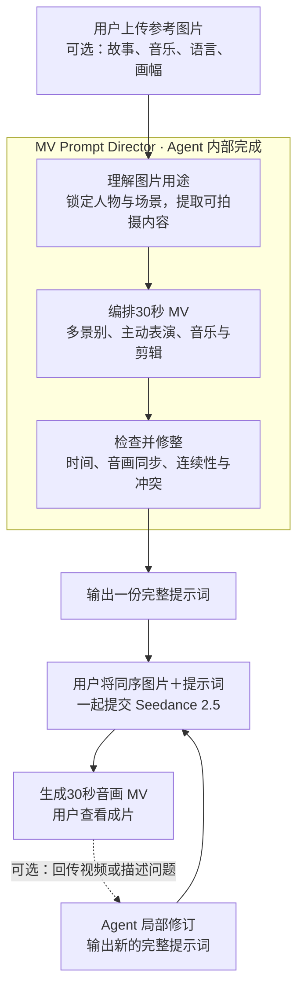

# MV Prompt Director · 使用指南

上传参考图片，可附一句创意，即可获得一份与图片一起提交给 Seedance 2.5 的30秒音乐 MV 完整提示词。Agent 负责分镜、表演、音乐、歌词、转场与连续性设计；视频由用户在生成平台制作。

## Skill 架构与使用路径

## 第一次使用

如果 Skill 已安装并在当前会话可用，上传图片后发送：

> 使用 $mv-prompt-director，根据这些图片创作30秒音乐 MV，给我可直接与图片一起提交 Seedance 2.5 的完整提示词。其余创作设定你来决定。

也可以附一句偏好，例如：

> 英文 K-pop，现实与梦境交错，前2秒高速闪切，人物表演自然，镜头有远中近变化。

不必准备分镜表或逐项填写参数。Agent 会直接完成；只有无法合理判断、会影响核心故事的缺口才会追问。想逐步讨论时，补充“先和我讨论方案，再出完整提示词”。

安装与通用加载方法见交付包中的「开始使用.md」。如果当前会话无法调用 `$mv-prompt-director`，可明确要求 Agent 读取本目录下 `SKILL.md`，并在输出前读取 `references/prompt-templates.md`。调用语法以所用 Agent 为准。

## 拿到提示词后

1. 根据提示词中的 `@图片1`、`@图片2` 等编号，保持图片上传顺序一致；平台标签不同则对应替换。
2. 复制完整代码块，连同图片提交生成。提示词已包含音乐与声音，无需另行拼接补充段落。
3. 按提示词选择平台当前可用的时长与画幅等设置。若界面限制与目标不符，把实际限制告诉 Agent 以便调整。
4. 查看成片中的人物、镜头、音乐与同步。需要改进时回传视频或描述，如“8–12秒人物没有演唱，其他保持”。Agent 将返回完整修订版。

## 默认与可覆盖项

- 默认目标：30秒、Seedance 2.5、完整音乐 MV 提示词。
- Agent 可补全：故事或情绪推进、音乐风格、歌词语言、画幅、镜头数和落版；会简短说明采用的设定。
- 用户可覆盖：以上所有创作设定，也可要求无歌词、指定音轨、单场景或其他模型。
- 图片不限于四张，场景不必按上传顺序出现；明确区分图片编号与叙事顺序。

“商业级”是创作与检查目标。Skill 的文件校验和提示词检查不等于成片验证，实际生成质量需要看视频确认。

## 使用授权

本产品采用单使用者商业授权，允许自用、内部修改及商业项目成果交付；不允许转售、共享或分发 Skill 本体及其修改版。完整范围见 [商业使用授权条款](LICENSE.md)。
